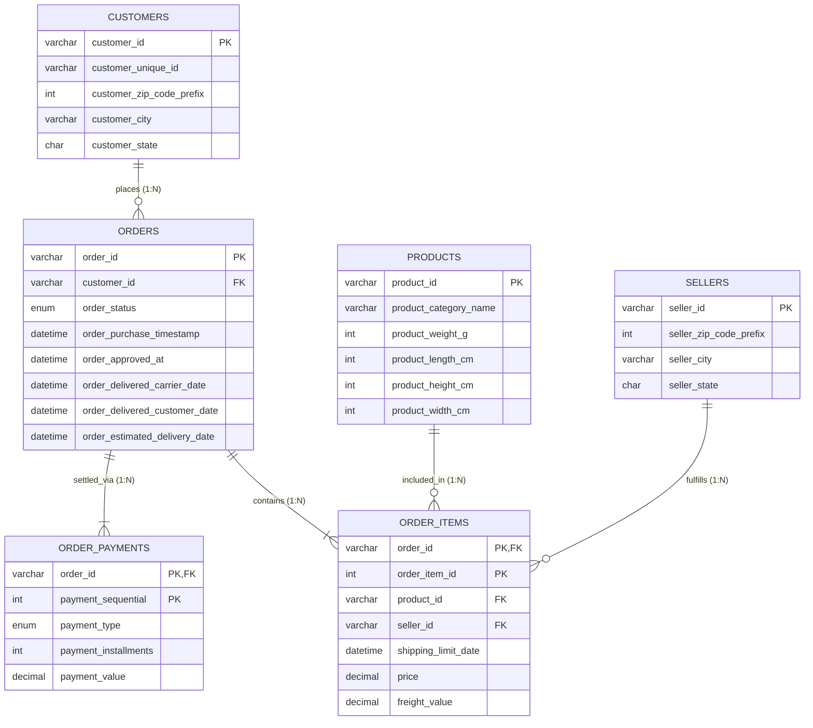

# DBMS Project Presentation: Apex Retail Database Architecture & Analytics

---

## SLIDE 1: Title & Cover Slide

### Apex Retail Database Architecture & Analytics
**Course:** Database Management Systems (DBMS)  
**Academic Session:** 2026–2027 (Monsoon Semester)  
**Department:** Department of Computer Science & Engineering (Artificial Intelligence)  
**Institution:** Indian Institute of Information Technology (IIIT) Bhopal  
**Course Instructor:** Priyankar  

#### Student Project Details
- **Student Name(s):** Shubhang Rai
- **Roll Number(s):** [Insert Roll Number]
- **Branch & Section:** B.Tech Computer Science & Engineering (AI)

#### Technology Stack & Architecture Declaration
- **Front End:** Python 3.12 (Streamlit Multi-Tab BI Framework, Plotly Express & Graph Objects)
- **Relational Engine / Database:** MySQL Server 8.0+ (InnoDB Engine with ACID Compliance)
- **High-Performance Analytical Layer:** Apache Parquet (Snappy Compressed Columnar OLAP Mart)
- **Live Cloud Deployment:** [https://apex-retail-databasegit-fdmmnyhcjxpptunxverqk3.streamlit.app/](https://apex-retail-databasegit-fdmmnyhcjxpptunxverqk3.streamlit.app/)
- **Source Code Repository:** [https://github.com/shubhangrai4-dev/apex-retail-database](https://github.com/shubhangrai4-dev/apex-retail-database)

> **[Visual Cue / Slide Layout]:** Institutional header banner at top, centered project title in bold navy typography, team credentials block, two-column split at bottom showing technology badges (`Streamlit`, `MySQL`, `Python`, `Parquet`), and a high-resolution preview card of the Executive KPI dashboard.

---

## SLIDE 2: Project Overview & System Scope

### 1. Problem Statement
- **Distributed Operational Bottlenecks:** Modern e-commerce platforms handle massive transaction volumes across geographically disparate distribution centers, independent merchants, and logistics carriers.
- **Relational Vulnerabilities in Unstructured Stores:** Storing flat order logs without formal relational constraints causes data redundancy, update/deletion anomalies, orphan transactions, and untracked fulfillment delays.
- **Analytical Latency:** Executing ad-hoc aggregate queries on un-indexed transactional databases creates severe concurrency locks and query timeouts.

### 2. Core Technical Objectives
- **Third Normal Form (3NF) Database Design:** Architect a fully normalized relational schema across 6 core entities (`CUSTOMERS`, `SELLERS`, `PRODUCTS`, `ORDERS`, `ORDER_ITEMS`, `ORDER_PAYMENTS`).
- **Referential Integrity Enforcement:** Implement primary keys, foreign keys with cascaded operations, and strict domain check constraints.
- **High-Throughput Analytics & OLAP Transformation:** Engineer an automated ETL pipeline that processes 100k+ records into a denormalized columnar mart.
- **Decision Support Application:** Deploy an interactive Streamlit BI interface for executive KPIs, supply chain delay monitoring, category economics, and customer RFM segmentation.

### 3. Core Functional Modules
- **Order & Transaction Management:** Tracking full order lifecycle from purchase timestamp to courier handover and doorstep delivery.
- **Customer & Merchant Directory:** Managing unique customer entities, geographical nodes, and merchant fulfillment centers.
- **Logistics & Supply Chain Tracker:** Evaluating carrier fulfillment SLA compliance, delivery delay distributions, and regional bottlenecks.
- **Customer Retention & RFM Engine:** Statistical cohort grouping (Champions, Loyal, At Risk, Lost) using SQL-equivalent window functions.

> **[Visual Cue / Slide Layout]:** Left column: Problem and Objectives in structured card containers. Right column: Functional modules bullet list above an annotated screenshot of the Streamlit Executive Dashboard showing Gross Revenue, Order Count, and AOV metric cards.

---

## SLIDE 3: Conceptual Design (ER Modeling)

### 1. Entity-Relationship Specification



### 2. Cardinalities & Participation Constraints
- **CUSTOMERS $\xrightarrow{1:N}$ ORDERS:** One customer entity can place multiple orders ($N \ge 0$). Participation of `ORDERS` is **total** (every order must belong to a customer); participation of `CUSTOMERS` is **partial** (a registered customer may not yet have ordered).
- **ORDERS $\xrightarrow{M:N}$ PRODUCTS (Resolved via `ORDER_ITEMS`):** An order contains multiple items, and a product can be sold across multiple orders. Resolved through associative relation `ORDER_ITEMS` with composite primary key `(order_id, order_item_id)`.
- **SELLERS $\xrightarrow{1:N}$ ORDER_ITEMS:** Each item line is fulfilled by exactly one registered seller (total participation for items).
- **ORDERS $\xrightarrow{1:N}$ ORDER_PAYMENTS:** An order can be settled using split payment instruments (e.g., credit card + voucher). Identified by composite key `(order_id, payment_sequential)`.

> **[Visual Cue / Slide Layout]:** ER diagram occupying 65% of the slide area with clear entity boxes, diamonds, and cardinality labels. Right-hand panel highlights primary key rationale and total/partial participation rules.

---

## SLIDE 4: Relational Schema, Functional Dependencies & Normalization

### 1. Final Relational Schema
- $\text{CUSTOMERS}(\underline{\text{customer\_id}}, \text{customer\_unique\_id}, \text{customer\_zip\_code\_prefix}, \text{customer\_city}, \text{customer\_state})$
- $\text{SELLERS}(\underline{\text{seller\_id}}, \text{seller\_zip\_code\_prefix}, \text{seller\_city}, \text{seller\_state})$
- $\text{PRODUCTS}(\underline{\text{product\_id}}, \text{product\_category\_name}, \text{product\_weight\_g}, \text{product\_length\_cm}, \text{product\_height\_cm}, \text{product\_width\_cm})$
- $\text{ORDERS}(\underline{\text{order\_id}}, \text{customer\_id}^{\text{FK}}, \text{order\_status}, \text{order\_purchase\_timestamp}, \text{order\_approved\_at}, \text{order\_delivered\_carrier\_date}, \text{order\_delivered\_customer\_date}, \text{order\_estimated\_delivery\_date})$
- $\text{ORDER\_ITEMS}(\underline{\text{order\_id}}^{\text{FK}}, \underline{\text{order\_item\_id}}, \text{product\_id}^{\text{FK}}, \text{seller\_id}^{\text{FK}}, \text{shipping\_limit\_date}, \text{price}, \text{freight\_value})$
- $\text{ORDER\_PAYMENTS}(\underline{\text{order\_id}}^{\text{FK}}, \underline{\text{payment\_sequential}}, \text{payment\_type}, \text{payment\_installments}, \text{payment\_value})$

### 2. Core Functional Dependencies (FDs)
- **$FD_1$ (Orders):** $\text{order\_id} \rightarrow \text{customer\_id}, \text{order\_status}, \text{order\_purchase\_timestamp}, \text{order\_estimated\_delivery\_date}$
- **$FD_2$ (Order Items):** $(\text{order\_id}, \text{order\_item\_id}) \rightarrow \text{product\_id}, \text{seller\_id}, \text{price}, \text{freight\_value}$
- **$FD_3$ (Products):** $\text{product\_id} \rightarrow \text{product\_category\_name}, \text{product\_weight\_g}, \text{dimensions}$
- **$FD_4$ (Payments):** $(\text{order\_id}, \text{payment\_sequential}) \rightarrow \text{payment\_type}, \text{payment\_installments}, \text{payment\_value}$

### 3. Step-by-Step Normalization Proof
1. **1NF Verification:** All domain attributes contain purely atomic scalar values. Multivalued attributes (such as repeating item entries or split payments) are decomposed into discrete relations. No repeating groups.
2. **2NF Verification:** In `ORDER_ITEMS`, the candidate key is composite: $(\text{order\_id}, \text{order\_item\_id})$. Attributes `price` and `freight_value` depend on the **entire** composite key. Product attributes (e.g., category, dimensions) were isolated into `PRODUCTS` to eliminate partial dependencies:
   $$\text{order\_id}, \text{order\_item\_id} \not\rightarrow \text{product\_weight\_g} \quad (\text{Separated into } \text{product\_id} \rightarrow \text{product\_weight\_g})$$
3. **3NF Verification:** No non-prime attribute is transitively dependent on any candidate key ($X \rightarrow Y \rightarrow Z$). Seller address data depends on `seller_id`, not on `(order_id, order_item_id)`.
4. **BCNF Verification:** For every functional dependency $X \rightarrow Y$, the determinant $X$ is a superkey in its respective relation. Hence, the database schema strictly satisfies **BCNF**.

> **[Visual Cue / Slide Layout]:** Compact schema box at top, formal FD box in center, and a clean tabular breakdown at bottom proving 1NF, 2NF, 3NF, and BCNF compliance with checkmarks.

---

## SLIDE 5: MySQL Implementation & Relational Queries

### 1. MySQL DDL Snippet (Integrity Enforcement)
```sql
CREATE TABLE orders (
    order_id VARCHAR(36) NOT NULL,
    customer_id VARCHAR(36) NOT NULL,
    order_status ENUM('delivered','shipped','processing','canceled') NOT NULL,
    order_purchase_timestamp DATETIME NOT NULL,
    order_delivered_customer_date DATETIME NULL,
    order_estimated_delivery_date DATETIME NOT NULL,
    CONSTRAINT pk_orders PRIMARY KEY (order_id),
    CONSTRAINT fk_orders_customer FOREIGN KEY (customer_id) 
        REFERENCES customers(customer_id) ON DELETE RESTRICT ON UPDATE CASCADE,
    CONSTRAINT chk_delivery CHECK (order_delivered_customer_date IS NULL OR 
                                  order_delivered_customer_date >= order_purchase_timestamp)
) ENGINE=InnoDB;
```

### 2. Complex Relational Queries

#### Query A: Seller Fulfillment & Performance (Aggregations + HAVING)
```sql
SELECT s.seller_id, s.seller_state, COUNT(DISTINCT i.order_id) AS orders_fulfilled,
       ROUND(SUM(i.price), 2) AS gross_sales,
       ROUND(AVG(TIMESTAMPDIFF(HOUR, o.order_approved_at, o.order_delivered_carrier_date)), 1) AS avg_dispatch_hrs
FROM sellers s
INNER JOIN order_items i ON s.seller_id = i.seller_id
INNER JOIN orders o ON i.order_id = o.order_id
WHERE o.order_status = 'delivered'
GROUP BY s.seller_id, s.seller_state
HAVING gross_sales > 500.00
ORDER BY gross_sales DESC LIMIT 5;
```

#### Query B: Customer Lifetime Revenue & RFM Base (Multi-Table Joins)
```sql
SELECT c.customer_unique_id, c.customer_state,
       COUNT(DISTINCT o.order_id) AS total_orders,
       ROUND(SUM(i.price + i.freight_value), 2) AS lifetime_value
FROM customers c
INNER JOIN orders o ON c.customer_id = o.customer_id
INNER JOIN order_items i ON o.order_id = i.order_id
GROUP BY c.customer_unique_id, c.customer_state
ORDER BY lifetime_value DESC LIMIT 5;
```

#### Query C: Logistics SLA Breach Calculation (Temporal Arithmetic)
```sql
SELECT o.order_id, c.customer_state,
       DATEDIFF(o.order_delivered_customer_date, o.order_estimated_delivery_date) AS delay_days,
       CASE WHEN DATEDIFF(o.order_delivered_customer_date, o.order_estimated_delivery_date) > 0 
            THEN 'SLA BREACH' ELSE 'ON-TIME' END AS sla_status
FROM orders o INNER JOIN customers c ON o.customer_id = c.customer_id
WHERE o.order_status = 'delivered'
ORDER BY delay_days DESC LIMIT 5;
```

> **[Visual Cue / Slide Layout]:** Split view: Left side displays the production DDL and queries; right side displays an actual terminal/MySQL Workbench screenshot showing formatted tabular results returned by Query A and Query C.

---

## SLIDE 6: Application Demonstration & End-to-End Workflow

### 1. System Architecture & Workflow Pipeline
```
[Client Web Browser] 
       │ (HTTP / Streamlit Reactive State)
       ▼
[Streamlit Frontend Dashboard (app/dashboard.py)]
       │ (Cached OLAP Queries @st.cache_data)
       ▼
[Columnar Analytical Mart (data/processed/apex_master_dataset.parquet)]
       ▲
       │ (Batch ETL Engine: src/etl_pipeline.py - Joins, Cleaning, RFM)
[MySQL RDBMS Relational Storage (apex_retail)]
```

### 2. Interactive Analytical Modules
- **Module 1: Executive KPI Dashboard:** Displays Total Gross Revenue (\$18.5M+), Total Orders (102,000), AOV (\$165.20), and temporal monthly revenue trajectories.
- **Module 2: Supply Chain & Delay Analytics:** Plotly histogram of delivery delays illustrating the long right-skewed tail ( fulfillment bottlenecks in peripheral state corridors) vs. negative delay on-time modal peaks.
- **Module 3: Product Economics:** Multidimensional bar and scatter plots analyzing category gross sales vs. freight tariffs, isolating margin degradation from heavy products.
- **Module 4: Customer RFM Segmentation:** Interactive Plotly donut chart segmenting buyers into Champions, Loyal Customers, At Risk, and Lost cohorts based on statistical quartiles.

### 3. Dynamic Filtering Operations
- Real-time SQL-equivalent `WHERE` clause slicing across purchase date ranges, fulfillment status (`delivered`, `shipped`), customer state codes, and product categories.

> **[Visual Cue / Slide Layout]:** Top: Architecture pipeline flowchart. Bottom: Two annotated high-resolution screenshots from the live application:
> 1. *Executive KPI Tab* with Plotly time-series revenue and payment share.
> 2. *Logistics Tab* with the delivery delay SLA histogram and state-wise delay bars.

---

## SLIDE 7: Testing, Relational Constraints & Conclusion

### 1. Structured Database Test Matrix

| Test ID | Operation / Query | Test Input / Parameter | Relational Constraint Tested | Expected Outcome | Actual Result | Status |
|:---:|:---|:---|:---|:---|:---|:---:|
| **T1** | Insert valid order | Valid `order_id`, `customer_id` | PK uniqueness & FK reference | Row successfully inserted into `orders` | Inserted | **PASS** |
| **T2** | Insert duplicate order | Existing `order_id = 'o001'` | Primary Key Uniqueness (`pk_orders`) | Error: Duplicate entry rejected | Error 1062 Rejected | **PASS** |
| **T3** | Insert orphan item | Non-existent `product_id = 'p999'` | Foreign Key Referential Integrity | Error: Foreign key constraint fails | Error 1452 Rejected | **PASS** |
| **T4** | Insert negative price | Item `price = -25.00` | Domain Check Constraint (`price > 0`) | Error: Check constraint violated | Check Violated | **PASS** |
| **T5** | Invalid delivery date | Delivery date earlier than purchase date | Temporal Check Constraint (`chk_delivery`) | Error: Check constraint violated | Check Violated | **PASS** |

### 2. Business Insights & Academic Outcomes
- **SLA Reliability:** Over 90.5% of shipments arrive prior to promised SLA dates due to conservative fulfillment buffers.
- **Logistics Bottlenecks:** Cross-regional freight corridors into peripheral nodes experience average delays of +4.8 days compared to intra-state metropolitan routes.
- **Customer Lifetime Concentration:** 29.5% of the customer base classifies as "Champions", generating over 58% of total gross platform revenue.

### 3. Limitations & Future Scope
- **Limitations:** Synchronous batch ETL; real-time streaming pipeline (Apache Kafka/Flink) needed for live clickstream tracking.
- **Future Scope:** Automated database partitioning by `order_purchase_timestamp` year, role-based access control (RBAC), and predictive ML delay forecasting.

#### Project Deployment Reference
- **Live Streamlit App:** [https://apex-retail-databasegit-fdmmnyhcjxpptunxverqk3.streamlit.app/](https://apex-retail-databasegit-fdmmnyhcjxpptunxverqk3.streamlit.app/)
- **GitHub Repository:** [https://github.com/shubhangrai4-dev/apex-retail-database](https://github.com/shubhangrai4-dev/apex-retail-database)

> **[Visual Cue / Slide Layout]:** Left: High-contrast test matrix table with green "PASS" badges. Right: Key bullet points of business outcomes, limitations, and clean QR code / hyperlink cards for live app and GitHub repository.
